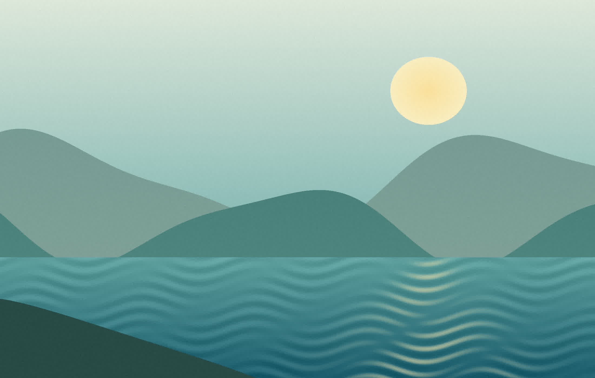

import { QuickCheck } from "./components/QuickCheck";
import tone from "./assets/quiet-tone.wav";

export { createSession } from "./components/QuickCheck";

<Slide id="opening" />

# Read a landscape

Look closely. Compare details. Explain your choice.

Start with what you can see before deciding what it means.

---

<Slide id="compare" columns={2} />

# Forest and open land

## Forest

- Trees provide cover.
- Plants support food webs.

## Open land

- Longer views across the ground.
- Less cover from trees.

---

<Slide id="image" />

# Look for visible details

Original Meowland illustration, not a photograph or scientific evidence.

---

<Slide id="steps" steps={3} />

# Build an explanation

<Reveal at={1}>

1. Describe the landscape.

</Reveal>

<Reveal at={2}>

2. Identify a useful feature.

</Reveal>

<Reveal at={3}>

3. Explain your evidence.

</Reveal>

---

<Slide id="check" />

# Quick check

<QuickCheck session={props.session} />

---

<Slide id="media" />

# Listen, then describe

<PresentationAudio src={tone} label="Optional quiet tone" />

An original six-second tone. Choose Play to listen; it is not a recording of this landscape.

---

<Slide id="summary" />

# Take it with you

- Describe before explaining.
- Use evidence for your comparison.
- Say what the evidence cannot show.
